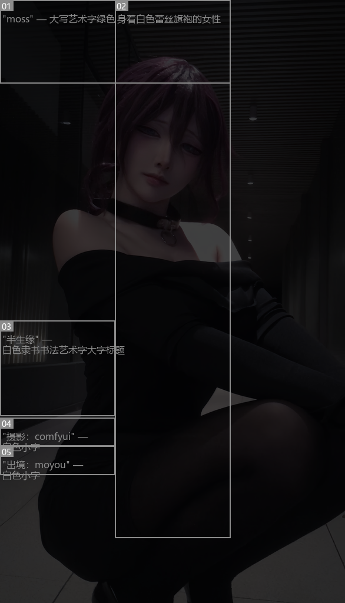
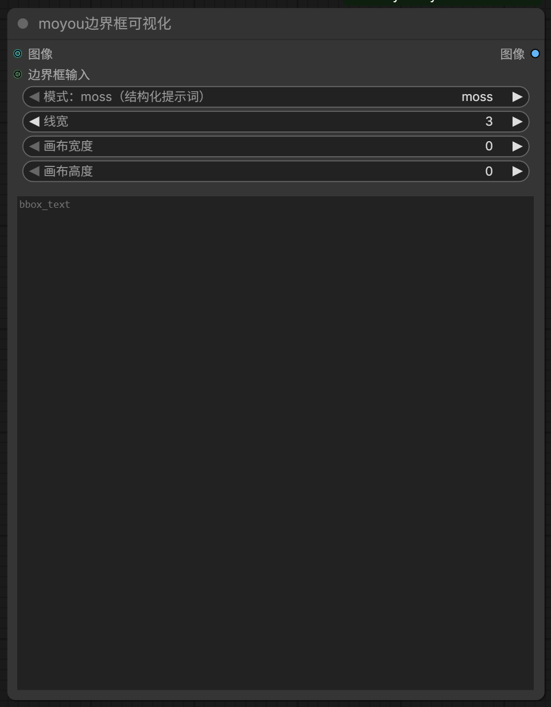
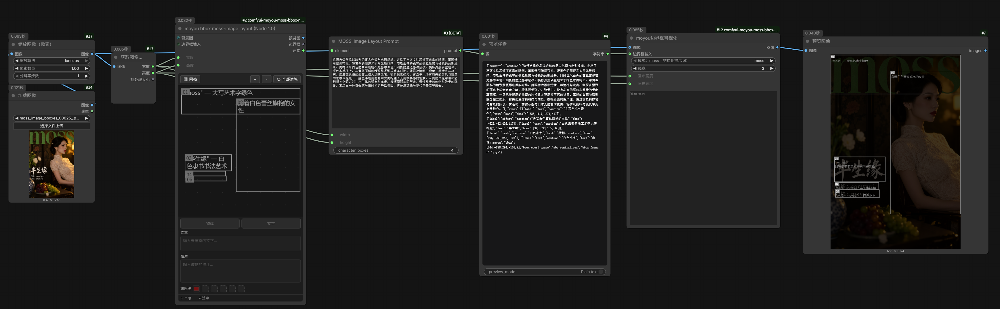
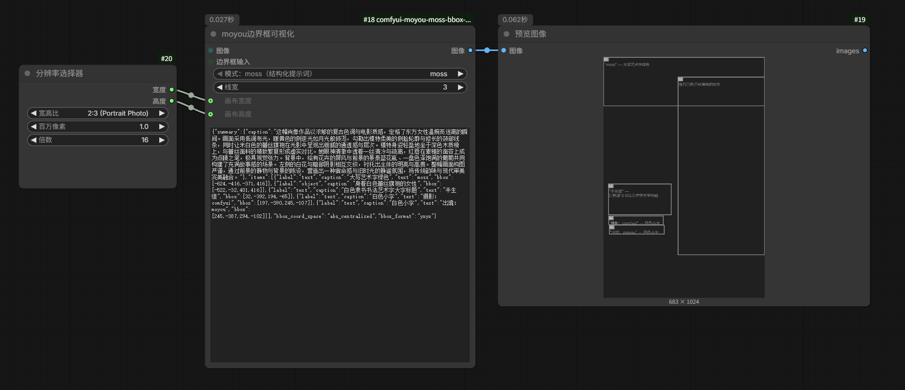
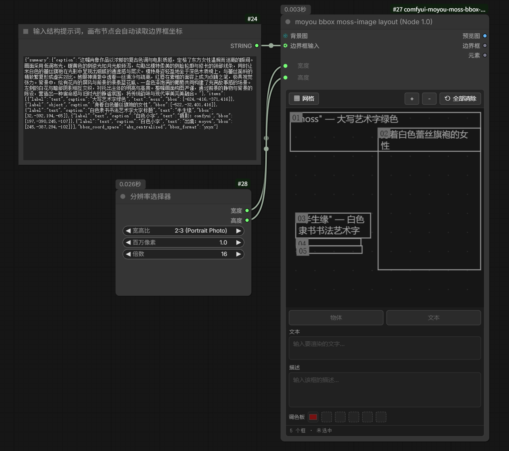

# comfyui-moyou-moss-bbox-node1.0

**更新：**

- 2026-10-23：修复 bbox 画布中边界框坐标不跟随宽高等比改变的 bug
- 2026-10-22：添加 边界框可视化 节点

**在 ComfyUI 的 Node 1.0（经典画布）上画 MOSS 边界框。**

ComfyUI 内置的「创建边界框 / Create Bounding Boxes」是 Node 2.0 节点——它的画布只由 Nodes 2.0 渲染器提供，
在经典画布下只剩一行 `Bounding Boxes：仅限 Node 2.0`，无法画框。

本插件把**同一套数据规则**（相同的 `editor_state` 结构、相同的 `elements` 输出格式）搬到一个经典节点里，
配上完整的可视化编辑器。数据与内置节点逐位兼容，可以互相替换。


---

## 特性

- **MOSS / Ideogram 元素输出**：`elements` 的 `bbox` 为 `[ymin, xmin, ymax, xmax]`，0–1000 归一化，与内置节点逐位相同
- **完整画布编辑器**：拖拽新建 / 移动 / 8 手柄缩放，框内实时显示文本与描述
- **元数据编辑**：类型（物体 / 文本）、文本、描述、最多 5 个调色板颜色
- **实时预览**：`preview` 输出画布渲染图（压暗背景 + 编号 + 描述文字），可直接接「预览图像」
- **宽高可连线**：`宽度` / `高度` 可以改成输入，接 `Primitive` 或尺寸节点；接上后画布与 `元素`
  输出都按新尺寸重新换算，构图不跑
- **上游初始化**：`bboxes` 输入可接像素框、`bbox_2d`、`elements` 或 JSON，上游变化时画布自动同步
- **全中文界面**：输入、输出、面板均为中文，内部字段名保持不变，旧工作流兼容
- **零额外依赖**：只用 ComfyUI 自带的 torch / PIL / numpy

## 安装

### 方式一：ComfyUI-Manager

搜索 `comfyui-moyou-moss-bbox-node1.0` 安装，或使用「通过 Git URL 安装」填入本仓库地址。

### 方式二：手动

```bash
cd ComfyUI/custom_nodes
git clone https://github.com/MoYouuuuuu/comfyui-moyou-moss-bbox-node1.0.git
```

然后**重启 ComfyUI**（新的 Python 节点与 `object_info` 只在启动时加载），刷新浏览器页面。

### 环境要求

| 项目 | 要求 |
| --- | --- |
| ComfyUI | 带有 `editor_state` / `elements` 内置节点（约 0.3.x 之后），本插件在 **0.42.0** 上验证 |
| Python | 3.10+（无第三方依赖） |
| 前端 | 需要支持 DOM widget 的版本（经典画布 / Nodes 2.0 均可），本插件在 **frontend 1.57.1** 上验证 |

## 使用

1. 双击画布空白处，搜索 **moyou** 或 `Node 1.0`，添加 **moyou bbox moss-image layout (Node 1.0)**（分类 `moyou`）
2. 设置 `宽度` / `高度`（默认 1024×1024），或把这两个输入拖出连线接到尺寸来源
3. 在画布上拖拽画框；选中框后，在下方编辑类型、文本、描述、调色板
4. 把 `元素` 接到 MOSS 图像节点的元素输入，或把 `预览图` 接到「预览图像 / 保存图像」

仓库内附带完整示例工作流：
[`moss_image_区域控制-node1.0适配-t2i工作流.json`](moss_image_%E5%8C%BA%E5%9F%9F%E6%8E%A7%E5%88%B6-node1.0%E9%80%82%E9%85%8D-t2i%E5%B7%A5%E4%BD%9C%E6%B5%81.json)
（`MOSSImageLayoutPrompt` + 本插件 + Flux sampling），可直接拖入 ComfyUI 打开。

### 操作速查

画布就是坐标系：框存的是像素值。改 `宽度` / `高度`（手填，或把这两个输入拖出连线送值）时，
存着的框会**按 new/old 等比缩放**，所以画布上看到的构图不变，`元素` 输出里的归一化坐标
也一个数都不变 —— 换个尺寸出图，构图别跑。

| 操作 | 说明 |
| --- | --- |
| 空白处拖拽 | 新建框 |
| 拖框内部 | 移动 |
| 拖四角 / 四边中点 | 缩放（8 个手柄） |
| 方向键 / Shift + 方向键 | 微移 1px / 10px |
| Delete / Backspace | 删除选中框 |
| 工具栏 `＋` / `－` / `⟲ 全部清除` | 居中加框 / 删选中 / 清空 |
| 工具栏「网格」 | 显示 / 隐藏点阵网格 |

页面左上角的状态栏实时显示：`框数量 · 选中编号 · 宽×高 @ (x, y) · 网格坐标`。

## 节点

### moyou bbox moss-image layout (Node 1.0)

节点 ID：`MoyouMossBoxesLayout`

| 输入 | 类型 | 说明 |
| --- | --- | --- |
| `宽度` / `高度` | INT | 画布与输出图尺寸，默认 1024×1024；可改成输入并连线（接 `Empty Latent Image` 的宽高最省事） |
| `背景图`（可选） | IMAGE | 画布与预览的背景图 |
| `边界框输入`（可选） | BOUNDING_BOX / ARRAY / STRING | 初始化画布；上游值变化一次则重置画布，不变时画布编辑优先 |

| 输出 | 类型 | 内容 |
| --- | --- | --- |
| `预览图` | IMAGE | 画布渲染图（压暗背景、编号、描述文字） |
| `边界框` | BOUNDING_BOX | 像素框帧 `[[{x, y, width, height}, ...]]` |
| `元素` | ARRAY | MOSS elements：`{"type", "bbox", "text", "desc", "color_palette"}` |

### moyou边界框可视化

节点 ID：`MoyouMossBoxesVisNode10`

把框画回一张图上做核对。`模式` 决定如何解读输入：

| 模式 | 读什么 | 坐标 |
| --- | --- | --- |
| `moss` | MOSS-Image 结构化提示词（`summary` + `items`） | 绝对像素，**原点在画布中心** |
| `yxyx` | elements / `bbox_2d` 列表 | 0–1000 归一化，`[y1, x1, y2, x2]` |
| `xyxy` | 同上 | 0–1000 归一化，`[x1, y1, x2, y2]` |

| 输入 | 类型 | 说明 |
| --- | --- | --- |
| `图像`（可选） | IMAGE | 底图。**不接也能跑**：直接在灰底图上画框，用来单独核对框位 |
| `模式` | 下拉 | 见下表 |
| `边界框输入`（可选） | BOUNDING_BOX / ARRAY / STRING | 优先于文本框；接编辑器或提示词节点的输出 |
| `画布宽度` / `画布高度` | INT | 见下 |
| `边界框文本` | 多行文本 | 直接粘贴 JSON（`moss` / elements / `bbox_2d` 都能贴） |
| `线宽` | INT | 框线宽度（像素） |

`画布宽度` / `画布高度` 只对 `moss` 模式生效：提示词里的 bbox 是**提示词制作时那块画布**的绝对像素，
所以这里要填提示词是按什么尺寸做的（默认 `0` = 用输入图自身的尺寸，没有图像时为 1024）。两者不一致时会自动等比缩放到图像上。

不接 `图像` 时输出 `画布宽度` × `画布高度` 的灰底图（同样按最长边 1024 缩放），框、编号、描述照常绘制，
所以可以把它当成一个纯「提示词框位检查器」单独挂在画布上看结果。



节点界面（模式下拉框旁会显示当前模式的中文含义）：



`moss` 模式可直接接 MOSS-Image Prompt Builder 的 `prompt` 输出（即 `预览任意` 里显示的那段 JSON），
用来核对提示词的框位是否与出图一致。

#### 完整链路

`加载图像 → 获取图像尺寸 → 布局节点（画框）→ MOSS-Image Layout Prompt → moyou边界框可视化 → 预览图像`，
布局节点画出来的框会一路变成提示词，再被可视化节点画回原图上核对：



#### 画布尺寸跟着分辨率走

`画布宽度` / `画布高度` 可以直接接「分辨率选择器」这类节点。输出的预览图就是该分辨率，
框按提示词的绝对像素重新落位（下图 2:3 竖图 → 683×1024）：



反过来也成立 —— 把已有的 MOSS 结构化提示词接到布局节点的 `边界框输入`（节点会自动读出框坐标），
再用分辨率选择器给 `宽度` / `高度`，就能在这套提示词上继续改框：




## 数据格式

画布内部数据结构与内置节点的 `editor_state` **完全一致**，单位为像素：

```json
{
  "x": 143, "y": 184, "width": 778, "height": 840,
  "metadata": { "type": "obj", "text": "", "desc": "knight", "palette": ["#FF8800"] }
}
```

输出的 `elements` 中，`bbox` 为 **0–1000 归一化、y 在前** 的 `[ymin, xmin, ymax, xmax]`：

```json
{ "type": "text", "bbox": [55, 0, 380, 1000], "text": "MOSS", "desc": "top banner" }
```

### MOSS 结构化提示词

MOSS-Image 的布局提示词是另一种形状（也是本插件 `moss` 模式读取的格式）：

```json
{
  "summary": { "caption": "" },
  "items": [
    { "label": "text",   "caption": "大写艺术字绿色", "text": "moss",
      "bbox": [-624, -416, -371, 416] },
    { "label": "object", "caption": "身着白色蕾丝旗袍的女性",
      "bbox": [-522, -32, 401, 416] }
  ],
  "bbox_coord_space": "abs_centralized",
  "bbox_format": "yxyx"
}
```

| 字段 | 含义 |
| --- | --- |
| `bbox_coord_space: abs_centralized` | 绝对像素，**原点在画布中心**（`abs_topleft` 则为左上角） |
| `bbox_format: yxyx` | 轴序 `[y1, x1, y2, x2]`（`xyxy` 为 `[x1, y1, x2, y2]`） |
| `label` | `object` / `character` / `text` |
| `caption` | 该框的内容描述 |
| `text` | `label: text` 时要渲染的字 |

本插件的映射：`caption` → `描述`，`text` → `文本`，`label: text` → 类型「文本」，其余 → 「物体」。
提示词里的 `summary`、`canvas`、每项的 `tags` 会原样保留，未被改动的提示词可无损回写。

> 中心坐标需要画布尺寸才能换算，而提示词本身不记录该尺寸——所以 `moss` 模式必须知道
> 提示词是按什么尺寸制作的（见上方的 `画布宽度`/`画布高度`）。MOSS-Image Prompt Builder 里
> `width`/`height` 填多少，这里就填多少。

> ⚠️ 与 `MoyouBBoxVis` 的 `bbox_2d`（`[x1, y1, x2, y2]`，0–1000）是两种不同的坐标排列：
> `bbox_2d` 的第三、四值是右下角坐标。直接喂给 `边界框输入` 时会按画布尺寸换算成像素。

## 兼容性说明

- 本插件**只注册自己的节点**，不修改、不接管任何 ComfyUI 内置节点
- 界面上的中文只是**显示名**（`localized_name` / `label`），内部字段名保持 `background` / `bboxes` / `width` / `height`，
  因此已有工作流与 API 调用完全兼容
- 与内置的同款节点可以在同一工作流中混用，两者的 `elements` 输出格式一致

## 已知限制

- 每个框最多 5 个调色板颜色（与内置节点一致）
- 画布最多按 0–1000 网格交互，超长边（>16384px）的框会按比例取整
- `layout` / `last_incoming` / `last_dims` 三个内部 widget 已隐藏，用于保存画布状态，请勿手动修改
- 连线驱动的 `宽度` / `高度`：前端拿不到连线对端的数值，只有对端是常量 INT（`Primitive`、
  `Int Literal` 之类，数值存在它唯一的数字 widget 里）时画布才会即时跟随。其它来源（「图像尺寸」、
  「分辨率选择器」这类运行时计算的节点）由**后端在运行时换算**：它用 `last_dims` 记住的旧画布和新
  尺寸把框等比缩一次，所以**这一次运行的 `元素` 就已经是对的**，同时把新尺寸回写给画布。

## 致谢

- 编辑器交互参考 ComfyUI-MoyouBBoxVis 的 "moyou bbox editor"
- 布局与数据规则对齐 ComfyUI 内置的 `CreateBoundingBoxes`（Node 2.0）

## 许可

[MIT](LICENSE)
