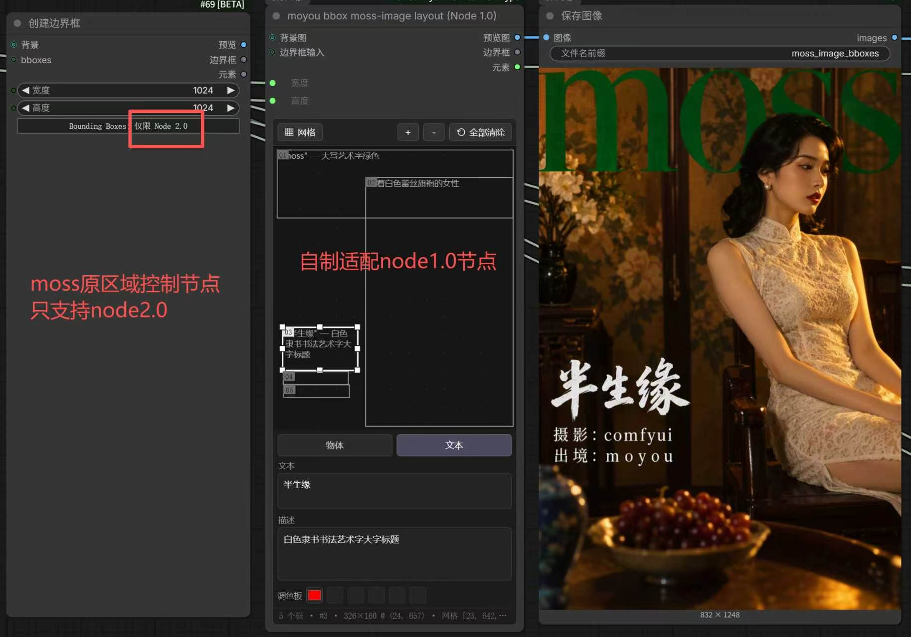
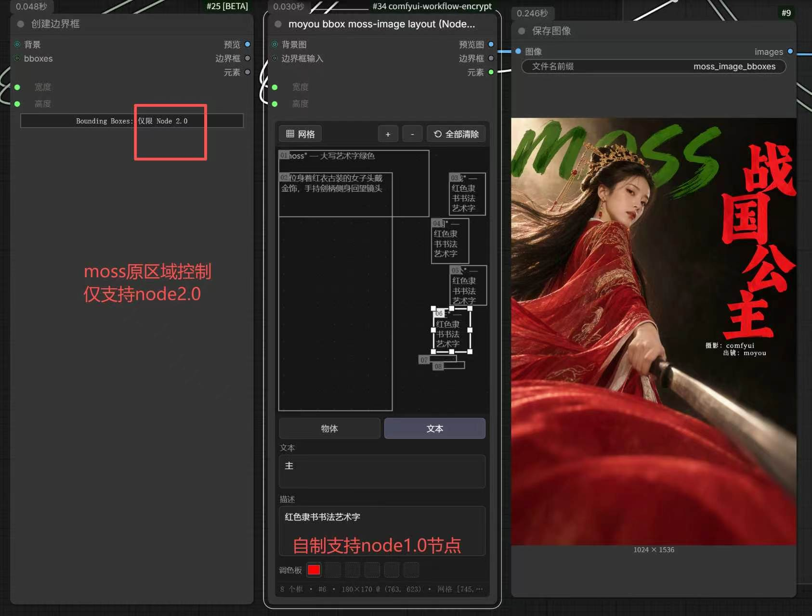

# comfyui-moyou-moss-bbox-node1.0

MOSS / Ideogram 边界框插件，按 **Node 1.0（经典 custom node）** 规则实现，不依赖 comfy_api V3。
内置「创建边界框 / Create Bounding Boxes」只能在 Node 2.0 用；这个插件把同一套数据规则搬到经典节点上。

## 效果

左边是内置「创建边界框」——画布区域只有一行 `Bounding Boxes: 仅限 Node 2.0`，Node 1.0 下不可用；
中间是本插件的节点，画布可直接拖拽增删改框、改描述和色板，输出接到「保存图像」直接出图。





## 界面布局（与 Node 2.0 对齐）

本插件自己的节点使用 `web/editorUI.js`，面板按内置节点在 Nodes 2.0 下的样子**纵向堆叠**：

```
┌──────────────────────────────────────┐
│  ▦ 网格              ＋  －  ⟲ 全部清除 │  ← 工具栏
├──────────────────────────────────────┤
│                                      │
│            画布（可拖拽）              │  ← 弹性高度
│                                      │
├──────────────────────────────────────┤
│        [ obj ]      [ 文本 ]          │  ← 分段控件
├──────────────────────────────────────┤
│ 文本                                  │
│ ┌──────────────────────────────────┐ │
│ └──────────────────────────────────┘ │
├──────────────────────────────────────┤
│ 描述                                  │
│ ┌──────────────────────────────────┐ │
│ └──────────────────────────────────┘ │
├──────────────────────────────────────┤
│ 调色板  [■] [□] [□] [□] [□]          │
├──────────────────────────────────────┤
│ 2 个框 · #2 · 778×840 @ (143, 184) … │  ← 状态栏
└──────────────────────────────────────┘
```

细节：

- 画布是**点阵网格**（可点「网格」开关），不是 Node 2.0 的实线格；
- 每个框在左上角显示编号 `01/02/…`，框内按 Node 2.0 的规则显示内容：
  文本类型显示 `"文字" — 描述`，物体类型只显示描述，超出框的部分裁剪；
- 框的描边用第一个调色板颜色，未设色板用灰色；选中框变白并显示 8 个缩放手柄；
- 画布四周留 5px 内边距，铺满全画布的框（0,0,1024,1024）也能看到边线和手柄；
- 未选中时，分段控件、文本、描述、调色板全部置灰禁用；选中后自动填入该框的值。

## 作用范围

本插件**只注册自己的节点**，不修改、不接管任何 ComfyUI 内置节点（`CreateBoundingBoxes` 保持原样）。

## 节点

| 节点 ID | 显示名 | 说明 |
| --- | --- | --- |
| `MoyouMossBoxesNode10` | moyou bbox moss-image layout (Node 1.0) | 画布编辑器 + MOSS `elements` 输出（主节点） |
| `MoyouMossBoxesLayout` | moyou bbox moss-image layout (Node 1.0) | 同一节点的别名（便于搜索） |
| `MoyouMossBoxesVisNode10` | 边界框可视化 | 把 elements / bbox_2d / 像素框 JSON 画回图片 |

界面全部中文：输入显示为「背景图 / 边界框输入 / 宽度 / 高度」，输出为「预览图 / 边界框 / 元素」，
面板为「网格 / 全部清除 / 物体·文本 / 文本 / 描述 / 调色板」。

> 只改**显示名**（`localized_name` / `label`），内部 `name` 保持 `background`/`bboxes`/`width`/`height` 不变，
> 所以已有工作流与 prompt 提交完全兼容。

### 创建边界框 (Node 1.0)

输入

| 名称 | 类型 | 说明 |
| --- | --- | --- |
| `width` / `height` | INT | 画布与输出图尺寸，默认 1024×1024 |
| `background`（可选） | IMAGE | 画布/预览的背景图 |
| `bboxes`（可选联接） | BOUNDING_BOX,ARRAY,STRING | 初始化画布：像素框、`bbox_2d`、elements 或 JSON 都接 |
| `layout` | STRING | 画布状态（隐藏 widget，前端读写） |
| `last_incoming` | STRING | 上一次用来初始化画布的上游值，用于判断上游是否变化（隐藏 widget） |

输出

| 名称 | 类型 | 内容 |
| --- | --- | --- |
| `preview` | IMAGE | 画布渲染图（压暗背景、编号标签、描述文字） |
| `bboxes` | BOUNDING_BOX | 像素框帧 `[[{x, y, width, height}, ...]]` |
| `elements` | ARRAY | MOSS elements：`{"type","bbox":[ymin,xmin,ymax,xmax],"text","desc","color_palette"}` |

### 坐标规则（与内置 Node 2.0 节点一致）

- 画布内部数据 = 内置节点的 `editor_state`：
  `{x, y, width, height, metadata:{type:"text"|"obj", text, desc, palette}}`，单位是**像素**。
- `elements[].bbox` = `[ymin, xmin, ymax, xmax]`，**0–1000 归一化、y 在前**，与内置节点逐位相同
  （已对内置节点做过逐元素比对：elements 完全相同，预览图逐像素相同）。
- 若把 `MoyouBBoxVis` 的 `bbox_2d`（`[x1,y1,x2,y2]`，0–1000）直接喂给 `bboxes`，会按 1024 换算成像素：
  这是两种不同坐标排列，`bbox_2d` 的第三、四值是右下角而不是宽高。

### 画布编辑器

编辑方式与 **ComfyUI-MoyouBBoxVis 的 "moyou bbox editor" 完全一致**：画布是一个挂在节点上的
`<canvas>` DOM widget，所有命中测试、拖拽和重绘都在这个 canvas 内部完成，坐标取自它自己的
`getBoundingClientRect()`，因此**不依赖 ComfyUI 画布（litegraph）的缩放/偏移**，在经典渲染和
Nodes 2.0 下行为相同，也不会出现"点几次就点不中"的错位。

- 左键空白处拖拽 = 新建框；拖框内部 = 移动；拖框四角/四边中点 = 缩放（8 个手柄，10px 命中容差）。
- 工具栏（画布上方一行）：`+` 居中加框、`−` 删选中、`清空` 全删、类型（物体/文字）、文字内容、描述 `desc`、
  X/Y/宽/高、5 个色板槽（点色块删除，右侧取色器添加）。
- 键盘：选中后方向键微移 1px（Shift=10px），Del/Backspace 删除。
- 状态栏显示 `boxes: N | #i | 像素 x=.. y=.. w=.. h=.. | 网格 [x1, y1, x2, y2]`。
- 画布按 0–1000 网格显示与拖拽（与内置 Node 2.0 画布一致），落盘时换算成 `width/height` 对应的像素值。
- 上游 `bboxes` 变化一次 → 画布重置为上游值；上游不变时，画布上的编辑优先（和内置节点同规则）。
- 拖拽期间监听挂在 `window` 上（鼠标移出画布也不中断），并在 `blur`/`visibilitychange` 时强制清理，
  避免拖拽卡死。
- 画布区域按节点实际绘制的行（未接线的输入槽 + 可见 widget）计算起点：`width`/`height` 接成输入时自动只让出两行槽位，
  不会和输入槽/widget 重叠；节点高度不够时会自动加高，保证画布至少 ~320px。

## 安装

1. 整个 `comfyui-moyou-moss-bbox-node1.0` 目录放到 `ComfyUI/custom_nodes/`。
2. **重启 ComfyUI**（新插件与 `object_info` 只在启动时加载），浏览器刷新页面。
3. 节点菜单搜「创建边界框」或「moyou」，分类 `moyou`。

依赖：ComfyUI 自带 torch / PIL / numpy，无需额外安装。

## 文件

| 文件 | 作用 |
| --- | --- |
| `__init__.py` | 两个节点的 INPUT_TYPES / 执行函数（经典 V1 写法，`FUNCTION="run"`），注册 mapper，`WEB_DIRECTORY="./web"` |
| `bbox_data.py` | 坐标与数据格式转换（像素框 ⇄ bbox_2d ⇄ elements），纯 Python，可单测 |
| `render.py` | 预览渲染；能导入内置 `comfy_extras.nodes_bounding_boxes` 时直接复用它的渲染器，否则用同逻辑的移植版 |
| `web/editorUI.js` | 画布编辑器 UI：Node 2.0 式纵向布局（工具栏/画布/obj·文本/文本/描述/调色板） |
| `web/moyouBoxes10.js` | 把编辑器挂到本插件自己的节点上 |
| `_selftest.py` | 自测：与内置 Node 2.0 节点的 elements / 预览逐位比对、上游值幂等、bbox_2d 兼容（`python _selftest.py`，需 ComfyUI 自带 python） |
| `_smoke/` | 浏览器冒烟脚本（Playwright + DevTools，验证画布渲染、拖拽、执行回传） |
| `_shots/` | 布局截图；`node10_*.jpg` 为与内置节点对照的实际出图 |

## 已验证（本机 ComfyUI 0.42.0 / frontend 1.57.1，Nodes 2.0 默认开启）

- `_selftest.py`：ALL PASS（16 项）——elements 与内置 Node 2.0 节点逐位相同、预览逐像素相同、上游值幂等、`bbox_2d` 兼容。
- 真实 8188（`_smoke/e2e.js`）：
  - 工作流加载后 `layout` 完整保留（243 字符 / 2 框），画布挂载、节点尺寸 640×760、画布 618×569；
  - `+` 加框得到 3 个框（原 2 个不丢），拖动/选中正常，描述改动能写回；
  - 执行成功，`ui.elements` 返回 3 条：
    `[{"type":"text","bbox":[55,0,380,1000],"text":"MOSS","desc":"top banner"},{"type":"obj","bbox":[180,140,1000,899],...},{"type":"obj","bbox":[481,520,682,720],"desc":"edited desc"}]`；
  - 连续运行 4 次后画布仍挂载、框数不变（无 `getCanvas: canvas is null` 崩溃、无重复 widget）。

## 实现要点（踩过的坑）

1. **DOM widget 数量必须从构造时稳定**：前端 `configure()` 按 widget 顺序配对 `widgets_values`，
   中途增删 widget 会让 `layout` 的值错位甚至被清空。所以画布 widget 在 `onNodeCreated` 就加好，之后只换 `element`。
2. **编辑器不能自己保存状态**：`layout` widget 是唯一数据源，每次修改前先 `syncFromWidget()` 回读，
   避免 `configure()` 赋值晚于编辑器初始化导致"编辑器空、widget 有值"。
3. **不要用 `app.canvas.graph_mouse` / `convertOffsetToCanvas` 做悬停判定**：Nodes 2.0 下这些值不可靠
   （`graph_mouse` 常为 `[0,0]`），这正是上一版"画布在节点外、点击无效"的原因。
